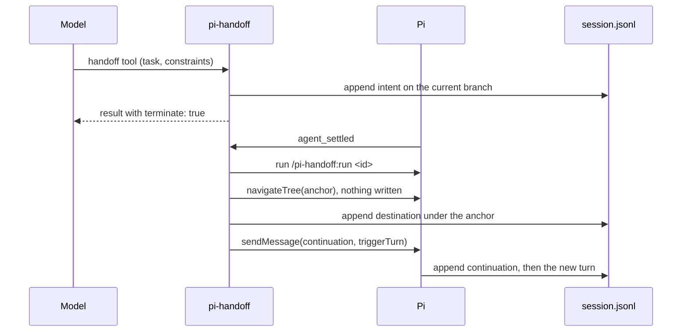

# pi-handoff

pi-handoff is a [Pi](https://pi.dev) extension that keeps related work in one session file while each model request stays small. When the context gets long, you or the model start a handoff. The extension then moves the session back to an anchor entry near the start, writes a short continuation message that carries the task and its constraints, and continues from there. The earlier work stays in the same file, and the model can search it with the `handoff_search` tool.

```text
session.jsonl
root ... anchor                  <- written once, when the session starts
         ├── archived work A     <- first handoff moved the leaf off this branch
         ├── archived work B     <- second handoff
         └── active work C       <- current leaf, what the model sees
```

## What the model sees on each request

Each request carries the fixed prefix up to the anchor, and then only the current branch. The archived branches stay in the file, but Pi leaves them out of the request.

```diff
 system prompt
 entries before the anchor
-archived work A (every message and tool result)
-archived work B
+continuation message (task, constraints, where the archive is)
+active work C
```

## Install

The package is only on GitHub, not on npm. Install it with Pi:

```bash
pi install git:github.com/bjoernaagaard/pi-handoff
```

Pi clones the repository, installs its dependencies, and loads the extension on the next start. `pi update --extensions` moves the clone to the newest commit on `main`. To stay on a release instead, add its tag, e.g. `git:github.com/bjoernaagaard/pi-handoff@v0.1.0`. To try the package for one session without saving it to your settings, run `pi -e git:github.com/bjoernaagaard/pi-handoff`.

The extension needs a session file, so it does nothing useful with `--no-session`.

### Verify a release archive

You can install a signed archive instead of the git package. You need [Packslip](https://packslip.dev/docs/install/), the GitHub CLI, and `jq`. Run these commands in an empty directory:

```bash
version=0.1.0
tag="v$version"
archive="pi-handoff-$version.tar.gz"
install_dir="$HOME/.local/share/pi-handoff/$version"
gh release download "$tag" --repo bjoernaagaard/pi-handoff --pattern "$archive" --pattern packslip.sigstore.json &&
packslip verify packslip.sigstore.json \
  --identity "https://github.com/bjoernaagaard/pi-handoff/.github/workflows/packslip-release.yml@refs/tags/$tag" \
  --issuer https://token.actions.githubusercontent.com \
  --artifact "$archive" --json > packslip-verified.json &&
jq -e --arg version "$version" --arg archive "$archive" \
  '.project == "github.com/bjoernaagaard/pi-handoff" and .version == $version and (.checked_artifacts | index($archive) != null)' \
  packslip-verified.json &&
mkdir -p "$(dirname "$install_dir")" &&
mkdir "$install_dir" &&
tar -xzf "$archive" -C "$install_dir" &&
(cd "$install_dir/pi-handoff" && npm install --omit=dev --legacy-peer-deps --no-audit --no-fund) &&
pi install "$install_dir/pi-handoff"
```

Packslip checks the archive, not the dependencies npm downloads. Pi does not update local packages. To update, verify and install the new archive, then remove the old local package with `pi remove`. Pi treats the new path as a separate package, so it does not show the old path's changelog updates.

## Usage

You can start a handoff yourself with the `/handoff` command, or the model can start one with the `handoff` tool. Both write the same record, and both continue the work once the current run ends.

| Entry point | Who uses it | What it does |
| --- | --- | --- |
| `/handoff <task>` | You | Archives the current work and continues with `<task>`. |
| `/handoff resume <id>` | You | Continues a handoff that stopped before navigation, e.g. after a crash. |
| `/handoff cancel <id>` | You | Marks such a stopped handoff as cancelled. |
| `handoff` tool | The model | Takes `task` and `constraints`, and ends the current run. |
| `handoff_search` tool | The model | Searches every branch of the session file for a substring. |

When you use `/handoff`, the first line is the task. Each later line that starts with `- ` becomes a constraint, and the extension quotes it word for word in the continuation message.

```text
/handoff Finish the migration of the billing tables
- Do not touch the users table
- Keep every migration reversible
```

The model sees a continuation message like this one at the start of the new branch:

```text
You are continuing work from an earlier part of this session. That earlier work is archived, not deleted. You cannot see it here, but you can search it with the handoff_search tool.

Task
Finish the migration of the billing tables

Constraints that still apply. They are quoted exactly. Follow every one.
- Do not touch the users table
- Keep every migration reversible

Where this came from
- Session file: /home/you/.pi/agent/sessions/.../2026-11-06T16-32-38-785Z_01a1b1b4.jsonl
- Session ID: 01a1b1b4-7f80-742f-b544-7b286c16cae2
- Last entry of the archived work: ae18a1b2
- Handoff ID: 394f651f-4df5-4c32-a2c9-49b87901f765

Files and outside changes made by the archived work are still in place. ...
```

If the archived work had tool calls that failed or never returned a result, the message lists them, so the model checks their real state before it runs them again.

## How a handoff runs

A handoff is a sequence of separate appends to the session file. The extension writes a record at each step, so it can tell after a restart how far a handoff got.



The `/handoff` command skips the tool call and the `agent_settled` step, because it writes the intent itself and continues once Pi is idle. Text that you type while a handoff is running is held, and the extension sends it after the continuation, so your message never lands directly under the anchor.

## Records in the session file

All records are plain custom entries, which Pi never sends to the model. The only exception is the continuation, which is a custom message that the model reads.

| Custom type | Written when | Parent entry |
| --- | --- | --- |
| `pi-handoff/anchor` | A new session starts | The session settings entries |
| `pi-handoff/intent` | A handoff starts | The tip of the work being archived |
| `pi-handoff/destination` | The leaf has moved to the anchor | The anchor |
| `pi-handoff/continuation` | Right after the destination | The destination |
| `pi-handoff/cancelled` | A handoff stops before its destination | The tip of the work |
| `pi-handoff/compaction-allowed` | A manual or overflow compaction runs | The current leaf |

The extension validates every record when it reads it, and it ignores a record that fails the check, because Pi doesn't validate session files and a file can be old or edited by hand. Each destination links to the previous one through `previousDestinationId`, so the order of handoffs doesn't depend on timestamps.

## Recovery after a restart

On every session start, the extension rebuilds the state of each handoff from its records. It changes the file only when a destination exists without its continuation, and a second restart then finds nothing to do.

```text
for each handoff in the session
  if it has a cancel record or a continuation
    do nothing
  else if it has an intent but no destination
    tell the user to run /handoff resume <id>
  else if the leaf is on its destination
    send the continuation once
  else
    report it and change nothing

if entries sit under the anchor outside every handoff
  report them, and handoff_search marks them orphaned
```

## Compaction

Automatic compaction would replace the fixed prefix with a summary, so the extension cancels compaction that starts because the context reached the threshold, and it tells you to run `/handoff`. It allows the other two kinds and records them.

```text
on session_before_compact(reason)
  if reason is threshold
    notify "run /handoff"
    cancel
  else (overflow or manual)
    append compaction-allowed record
    allow
```

Pi needs overflow compaction to recover a turn that went over the model's context window, so cancelling it would stall that turn.

## Search

The `handoff_search` tool takes a `query` and an optional `limit` from 1 to 20, with a default of 8. It does a case-insensitive substring match over user, assistant, tool result and custom message entries on every branch, and it returns the newest hits first. Each hit has an excerpt of at most 1,200 characters.

```json
{
  "sessionFile": "/home/you/.pi/agent/sessions/.../session.jsonl",
  "sessionId": "01a1b1c3-b2a9-70f7-9632-c94b7e00600d",
  "entryId": "0da39b12",
  "timestamp": "2026-11-06T16:49:17.859Z",
  "status": "abandoned",
  "hiddenByCompaction": false,
  "handoffId": null,
  "excerpt": "Alternative idea: try MONGO-BETA for the database instead. Reply with ok."
}
```

The status tells the model how to treat each hit:

```text
status =
  current    if the entry is on the current branch
  archived   if the entry is on the path of a finished handoff
  orphaned   if the entry sits under the anchor outside every handoff
  abandoned  otherwise, e.g. an alternative branch that was dropped
```

`hiddenByCompaction` is true when the entry is on the current branch but before the latest compaction, so the model can no longer see it directly.

## Limits

The extension works only through Pi's public extension API, so it can't make the following guarantees.

- A handoff isn't atomic. It is several separate appends, and Pi doesn't call fsync, so a power failure can lose the last records.
- Navigation changes only the session. Files that the archived work wrote, and any other outside effects, stay in place.
- Search returns bounded excerpts, so it doesn't promise to find every mention.

## Source layout

```text
src/
├── extension.ts     # entry point, anchor, compaction policy, capture hook
├── records.ts       # record schemas, validation, grouping by handoff
├── handoff.ts       # handoff tool, /handoff, lifecycle, held input
├── continuation.ts  # continuation message text
├── reconcile.ts     # recovery on session start
└── search.ts        # handoff_search tool
```

## Development

You need Node and npm. Pi loads the TypeScript source directly, so there's no build step.

```bash
npm install
npm run check
pi -e ./src/extension.ts
```

The pre-commit hook runs `npx ultracite fix` on staged files. Three environment variables help when you demonstrate or debug a handoff by hand:

| Variable | Effect |
| --- | --- |
| `PI_HANDOFF_PAUSE_AT` | Holds the handoff at `during-navigate`, `after-navigate` or `after-destination`, so you can kill Pi or type at that point. |
| `PI_HANDOFF_PAUSE_MS` | Ends that hold after the given number of milliseconds. Without it, the hold lasts until Pi exits. |
| `PI_HANDOFF_CAPTURE` | Saves every provider request payload as `<dir>/<n>.json`. |

`HANDOFF.yaml` holds the original implementation brief, with the Pi 1.5.0 source lines that each design choice relies on.

## License

The code is released under the MIT license, which is in [LICENSE](LICENSE).
